# T2I field-signature experiment

This research project asks whether an image model's response to a prompt resembles its responses to safe or unsafe reference prompts. It records each prompt's influence at fixed model states, compares those records, and tests whether moving a record toward an approved safe reference satisfies the chosen acceptance rules.

The current experiment compares **five methods in two modes**. Its outputs describe prompt-label detection and changes to frozen field records; they do not measure generated-image safety or preservation of a prompt's meaning.

- [Main results](data/flow_t2i_two_mode_1000/comparison.md)
- [Additional intended-benign control results](data/flow_t2i_two_mode_1000/additional_tests/style_matched_safe_prompts_1000/comparison.md)
- [Commands and retained dependencies](docs/latest-experiment.md) · [Active settings](configs/t2i_two_mode_comparison.toml)
- [H0: overview](#h0-global-pipeline) → [H1: commands](#h1-core-workflows) → [H2: subworkflows](#h2-subworkflows) → [H3: actions](#h3-actions-and-shared-primitives)
- [GPU workflows](#gpu-execution-and-transfer) · [Repository map](#repository-map) · [Hierarchy findings](#hierarchy-findings)

## How to read this map

The hierarchy follows section 2 of [Clean code.md](Clean%20code.md), the guide selected for this README; `Clean code - updated.md` is absent from this checkout.

| Level | Guide's contract | Existing implementation |
|---|---|---|
| H0 | A separate orchestrator calls H1 functions only. | No global pipeline function exists. Commands exchange saved files. |
| H1 | One `run_<core_step>()` per step file, calling same-file H2 functions. | The six scripts' `main()` functions are the existing command orchestrators. |
| H2 | Unprefixed subworkflow calling same-file H3 actions only. | Functions dispatched by those command orchestrators coordinate the work. |
| H3 | Atomic action named `_verb_object()`. | Existing actions include shared primitives and helpers containing further calls. |

**Levels below describe existing responsibilities, not compliance.** For example, `run_extraction()` has an H1-style name but sits beneath the extraction command's `main()`; that naming/role conflict remains explicit. Shared functions can appear at different call depths; reuse does not establish a compliant fixed hierarchy.

Every function node keeps its exact name, qualified where needed. Solid arrows show call order **within the containing workflow**, rather than implying that one sibling calls the next. H0's dashed arrows are **command dependencies**, because there is no caller for the complete sequence. Conditions and inline operations appear in prose or edge labels, never as invented function nodes.

H1 diagrams show H2 dispatch only; direct lower-level calls are flagged separately. H2 diagrams show actual direct project calls at the next depth. The H3 reference identifies composite helpers and their deeper calls instead of inventing missing layers; library calls and inline work are summarized in prose. Repeated equivalent read/hash calls may share a node, with significant branches and dependencies retained.

### Research vocabulary

| Term | Meaning here |
|---|---|
| Signature | A saved record of how a prompt changes the model's direction at fixed states. |
| Probe bank | The frozen states where all prompts are measured, making their signatures comparable. |
| Reference / anchor | A prompt used as a fixed example of the safe or unsafe class. |
| Calibration | Separate prompts used to choose acceptance cutoffs after references are fixed. |
| Held-out test | Prompts used to evaluate a rule, without fitting cutoffs or weighting. |
| Steering | Searching mixtures of a query signature and an approved safe signature. The active workflow does not generate images from these mixtures. |

`trajectory` probes several points on previously sampled safe model paths; `source_slice` uses their paired initial noise states. [VARIANTS](backend/flow/comparison.py) defines three trajectory methods—nearest reference (`euclidean`), mean reference (`anchor_static`), and distance-weighted references (`anchor_adaptive`)—and the two anchor methods for the source slice.

`safe_attraction` accepts signatures within the safe cutoff. `safe_attraction_unsafe_avoidance` also requires them to lie strictly outside the unsafe cutoff; equality at the unsafe boundary is rejected.

## H0: Global pipeline

Inputs are the retained safe experiment, the risky-prompt dataset, and experiment settings. The main commands produce frozen inputs, new unsafe signatures, distance tables, and ten method/mode reports; the optional control branch produces separate reports using the parent's fitted rules.

**No H0 caller exists.** This is the command sequence from [latest-experiment.md](docs/latest-experiment.md), with actual H1 entry functions as nodes. Group captions identify modules, so repeated `main` labels remain unambiguous.

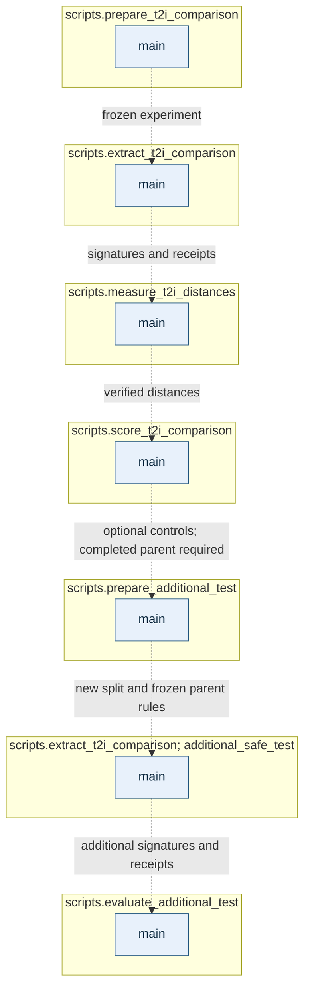

Follow the [H1 command sections](#h1-core-workflows) for source links and lower-level diagrams.

### Running the workflow

Use Python 3.12 or later from the repository root. Extraction requires access to the configured model and a suitable GPU; distance measurement defaults to CUDA and accepts `--device cpu`.

```powershell
python -m pip install -r requirements-flow.txt
python -m scripts.prepare_t2i_comparison
python -m scripts.extract_t2i_comparison
python -m scripts.measure_t2i_distances
python -m scripts.score_t2i_comparison
```

The safe experiment is a prerequisite, not reconstructed by these commands. [safe_source_path()](backend/flow/comparison.py) resolves the historical source to `data/flow_t2i_two_mode_1000/reused_safe_source` when its original manifest is missing; `data/cache/T2I-RiskyPrompt.json` supplies unsafe prompts.

After the main comparison, evaluate supplied intended-benign controls separately:

```powershell
python -m scripts.prepare_additional_test --input PATH_TO_ORIGINAL_CONTROLS_JSON
python -m scripts.extract_t2i_comparison --output data/flow_t2i_two_mode_1000/additional_tests/style_matched_safe_prompts_1000 --split additional_safe_test
python -m scripts.evaluate_additional_test
```

Supply `--input` explicitly: otherwise control preparation chooses the newest JSON in the user's Downloads directory. Main preparation accepts `--config`; extraction, measurement, scoring, and evaluation accept `--output`, while control preparation fixes its parent/output paths in module constants.

Completed caches are retained. Preparation rejects incompatible frozen inputs; extraction validates existing signatures or records supplied resume hashes, and measurement verifies feature bytes before accepting a cached table. Different frozen inputs require a fresh output folder.

## H1: Core workflows

### H1-1: Prepare the main experiment

[Source: main()](scripts/prepare_t2i_comparison.py) · [H2: prepare()](#h2-1-main-preparation)

Given settings identifying the safe source, risky dataset, and output folder, this command freezes the experiment inputs. Its output is a prepared manifest, reused safe artifacts, new unsafe partitions, and initial status.

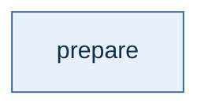

**Boundary deviation:** `main()` parses arguments and calls shared `load_config()` directly before `prepare()`.

### H1-2: Extract signatures

[Source: main()](scripts/extract_t2i_comparison.py) · [H2: run_extraction()](#h2-2-extraction)

Given a prepared folder and optional split/resume receipt, this command records signatures in both probe spaces. It produces feature files, extraction status, transfer bundles, and provenance receipts.

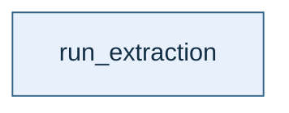

Defaults are `unsafe_reference`, `unsafe_validation`, and `unsafe_test`; selecting `additional_safe_test` also changes the provenance filename. **Boundary deviations:** argument parsing, thread settings, and direct `read_json()` for supplied `--precomputed` data occur in `main()`.

### H1-3: Measure distances

[Source: main()](scripts/measure_t2i_distances.py) · [H2: measure_space()](#h2-3-main-distance-measurement)

Given extracted signatures and frozen inputs, compute distances from prompts to both reference classes. Save verified tables for `trajectory`, then `source_slice`, and mark distance analysis complete.

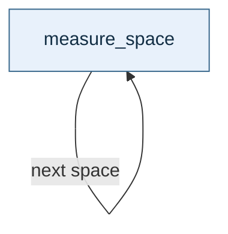

**Boundary deviations:** `main()` handles arguments/threads and calls `write_json()` directly for completion status.

### H1-4: Score and report

[Source: main()](scripts/score_t2i_comparison.py) · [H2: score_space()](#h2-4-main-scoring) · [H2: report()](#h2-5-reporting)

Given verified distance tables, fit rules on references/calibration prompts and evaluate held-out tests. Produce ten sets of decisions/steering records plus combined Markdown, CSV, and JSON comparisons.

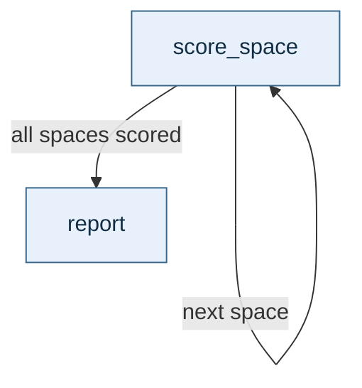

**Boundary deviations:** `main()` parses arguments and writes completion status directly through `write_json()` after reporting.

### H1-5: Prepare additional controls

[Source: main()](scripts/prepare_additional_test.py) · [H2: prepare()](#h2-6-additional-control-preparation)

Given explicitly intended-benign prompts and a completed parent, create a separate evaluation folder. It contains the new split and copies of parent decision rules and required reference data.


**Boundary deviation:** input discovery, including the Downloads fallback, happens directly in `main()`.

### H1-6: Evaluate additional controls

[Source: main()](scripts/evaluate_additional_test.py) · [H2: measure()](#h2-7-additional-control-distances) · [H2: score()](#h2-8-additional-control-scoring) · [H2: report()](#h2-5-reporting)

Given new signatures and frozen parent state, evaluate controls against the original unsafe tests. Produce a separate ten-result comparison without fitting new cutoffs or weighting rules.

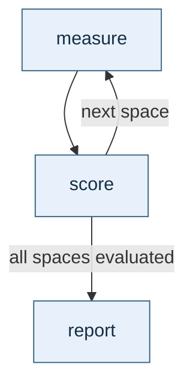

Measurement/scoring finish for one space before the next. **Boundary deviations:** `main()` configures threads and writes status directly; the script imports helpers from the main scoring step.

## H2: Subworkflows

Each diagram expands its parent to the next actual call depth. See [H3](#h3-actions-and-shared-primitives) for purposes, sources, and composite-helper violations.

### H2-1: Main preparation

[Source: prepare()](scripts/prepare_t2i_comparison.py) · [Parent H1](#h1-1-prepare-the-main-experiment) · [Input actions](#input-and-storage-actions)

Given settings and an existing safe experiment, check safe partitions and select disjoint unsafe references, tests, and calibration prompts. Reuse safe signatures, paired banks, and distance caches, then save the manifest and prepared status.

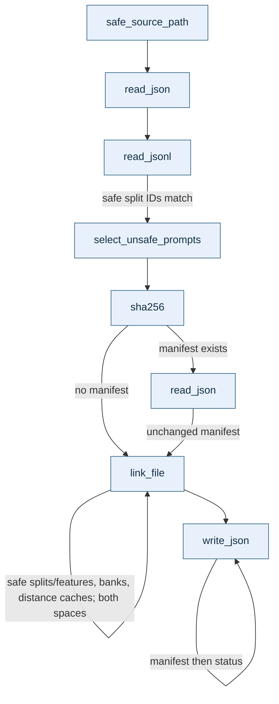

Unsafe partition files are written inline between reuse operations. Changed manifests, unsafe split contents, safe split order, conflicting reused files, or overlapping source/output directories stop preparation.

### H2-2: Extraction

[Source: run_extraction()](scripts/extract_t2i_comparison.py) · [Parent H1](#h1-2-extract-signatures) · [Model actions](#prompt-selection-and-model-actions) · [Checkpoints](#checkpoint-and-distance-actions)

Given a prepared experiment, load both frozen banks and evaluate prompts only where signatures are missing. Validate existing files, account for separately transferred resume features, and save per-space receipts and transfer bundles.

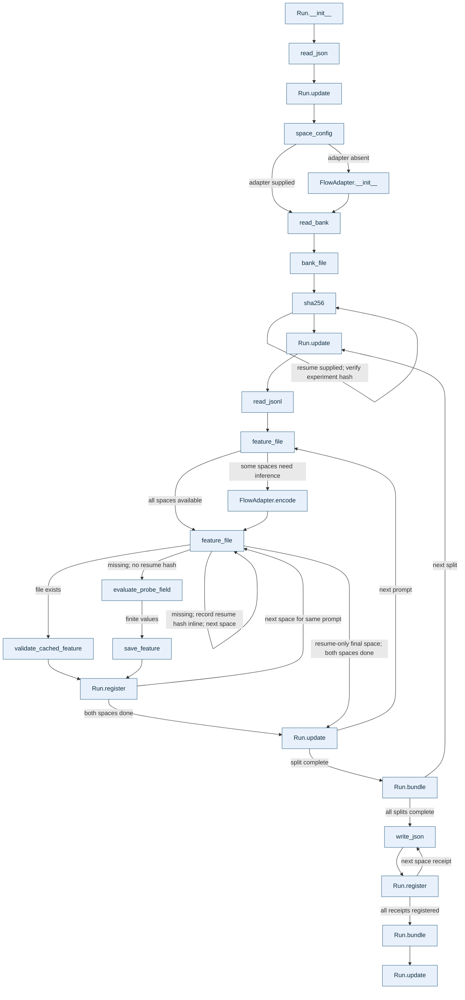

Both spaces finish before prompt progress updates; newly needed embeddings are computed once per prompt. Resume-only features have hashes/counts recorded inline without loading their bytes here; measurement verifies them later. Receipt writes also call `sha256()` for experiment identity before each `write_json()`.

Failures inside the protected loop call `Run.bundle(force=True)`, then `Run.update(status="failed", ...)`, then re-raise. Setup before the `try`—model/bank loading and resume-manifest checks—does not pass through that handler; success flushes remaining files before complete status.

### H2-3: Main distance measurement

[Source: measure_space()](scripts/measure_t2i_distances.py) · [Parent H1](#h1-3-measure-distances) · [Distance actions](#checkpoint-and-distance-actions)

Given one space's signatures, verify their identity and build distances to both reference classes. Reuse safe-to-safe distances and save new combinations with an input-bound receipt.

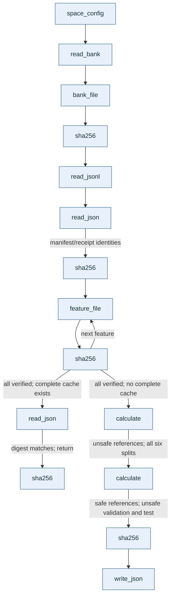

Nested `calculate()` is a **composite**, not atomic H3: it calls nested `load()` → `flat_feature()`, then `euclidean_matrix()` and `write_json()` per batch. Between the two `calculate()` calls, inline work zeroes unsafe-reference self-distances, loads original safe rows, and obtains unsafe-reference-to-safe-reference distances by transposing their opposite-direction table; the combined archive is saved inline before hashing.

Every feature hash is checked before cached tables can be reused. Changed banks, splits, receipts, or feature bytes raise an error.

### H2-4: Main scoring

[Source: score_space()](scripts/score_t2i_comparison.py) · [Parent H1](#h1-4-score-and-report) · [Scoring actions](#scoring-and-steering-actions)

Given verified distances, fit each method's safe/unsafe rules on references and calibration prompts. Evaluate both modes on held-out tests and write calibration, decisions, steering records, and reports.

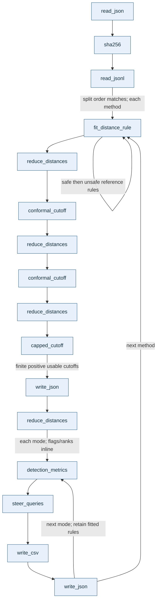

The three calibration reductions use safe-validation distances to safe references, unsafe-validation distances to unsafe references, and safe-validation distances to unsafe references. The unsafe cutoff is capped using safe calibration; no test prompt fits a cutoff or adaptive width. Receipt/split mismatches fail before fitting.

### H2-5: Reporting

[Main report()](scripts/score_t2i_comparison.py) · [Additional report()](scripts/evaluate_additional_test.py) · Parents: [main](#h1-4-score-and-report), [additional](#h1-6-evaluate-additional-controls) · [Actions](#reporting-actions)

Each module defines a separate `report()` with the same project-call pattern below. Given a manifest and accumulated results, write JSON/CSV/Markdown comparisons, then save hashes identifying artifacts, relevant inputs, and selected implementation files.

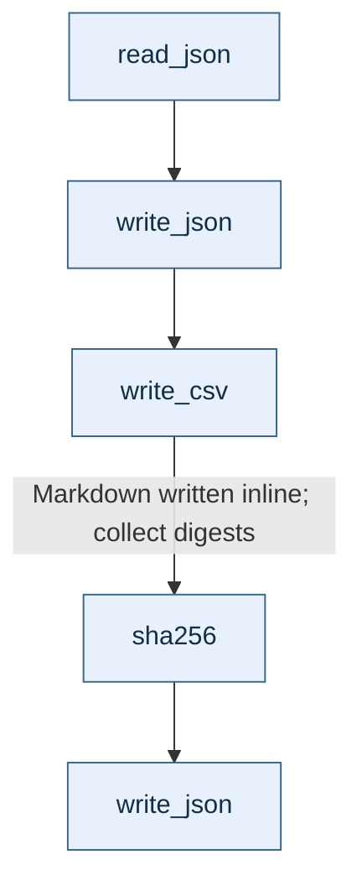

The main report compares original safe/unsafe tests and steering. The additional report keeps original safe results separate, compares new intended-benign controls with original unsafe tests, and gives control-category rejection rates; supplied labels have no human/generated-image safety validation, and the original coverage assumption does not establish a 5% guarantee for this new distribution.

### H2-6: Additional-control preparation

[Source: prepare()](scripts/prepare_additional_test.py) · [Parent H1](#h1-5-prepare-additional-controls) · [Input actions](#input-and-storage-actions)

Given controls and a completed parent, verify parent artifacts and reject empty, duplicate, overlapping, or incorrectly labelled controls. Save the new evaluation split, fixed parent rules, reference banks/features, and parent distance slices needed for evaluation.

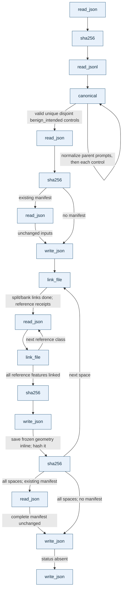

The source JSON, copied comparison, control JSONL, and geometry archives are read/written inline. Controls receive stable IDs and evaluation-only metadata; mismatched parent artifacts or changes to an existing additional manifest stop preparation.

### H2-7: Additional-control distances

[Source: measure()](scripts/evaluate_additional_test.py) · [Parent H1](#h1-6-evaluate-additional-controls) · [Distance actions](#checkpoint-and-distance-actions)

Given new signatures and frozen references, verify parent rules, bank identity, row order, and feature hashes. Compute distances from every control to safe/unsafe references and save a separate cache/receipt.

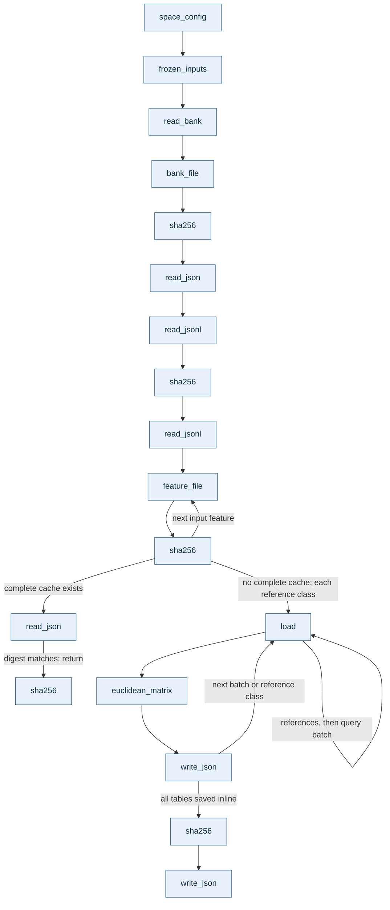

`frozen_inputs()` and nested `load()` are composite helpers; `load()` delegates to `flat_feature()`. New controls never enter reference selection/calibration, including on a cache hit.

### H2-8: Additional-control scoring

[Source: score()](scripts/evaluate_additional_test.py) · [Parent H1](#h1-6-evaluate-additional-controls) · [Scoring actions](#scoring-and-steering-actions)

Given additional distances and copied parent geometry, apply all five fitted rules in both modes. Confirm original unsafe rejection rates, evaluate controls, and save decisions, steering records, and reports.

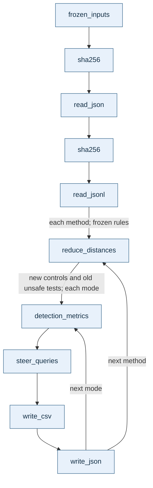

Archives are loaded inline after receipt checks; flags/ranks are calculated inline per mode. A changed original unsafe flagged rate raises before `detection_metrics()`; there are no fitting/cutoff calls here.

## H3: Actions and shared primitives

These tables give each action's input-to-output purpose and source. **Composite** entries expose actual calls beyond the intended atomic layer; names remain unchanged. Leaves using libraries/inline operations need no invented lower-level diagram.

### Input and storage actions

| Function and source | Purpose |
|---|---|
| [load_config](backend/flow/common.py) | Read TOML settings and return their values. |
| [resolved_path](backend/flow/common.py) | Resolve a configured path against the repository when needed. |
| [read_json](backend/flow/t2i_prompts.py) | Read one JSON value, such as a manifest/receipt. |
| [read_jsonl](backend/flow/t2i_prompts.py) | Read ordered prompt records stored one per line. |
| [sha256](backend/flow/common.py) | Return a file fingerprint to detect changed bytes. |
| [write_json](backend/flow/common.py) | Save structured data, creating parent folders. It writes directly; callers needing atomic replacement supply a temporary path. |
| [safe_source_path](backend/flow/comparison.py) | Resolve the historical safe-source location to the retained cache when appropriate. |
| [link_file](backend/flow/comparison.py) | Reuse an artifact via hard link, falling back to a copy. Distinct existing files must have matching `sha256()` values. |
| [space_config](backend/flow/comparison.py) | Read the manifest and return one space's settings; use one probe time for `source_slice`. Its default scoring setting does not replace the explicit five-method loop. |
| [canonical](backend/flow/prompt_records.py) | Normalize text for duplicate detection, ignoring case/punctuation differences while retaining meaningful Unicode characters. |

### Prompt selection and model actions

| Function and source | Purpose and further calls |
|---|---|
| [select_unsafe_prompts](backend/flow/t2i_prompts.py) | **Composite:** `read_json()` loads prompts; `canonical()` excludes duplicates/safe overlap. Keep the three supported categories, assign multi-label rows once using the reversed category priority in code, deterministically order candidates, then fill references, tests, and calibration in that order while balancing available categories. Return disjoint ID-sorted groups. |
| [FlowAdapter.__init__](backend/flow/model.py) | **Composite:** load the configured Stable Diffusion 3 checkpoint and validate model/device settings. Call `_pipeline_class()`, then `_native_null()`, then `model_signature()` to establish the model interface/identity. |
| [_pipeline_class](backend/flow/model.py) | Locate the installed Stable Diffusion 3 pipeline class or raise an availability error. |
| [FlowAdapter._native_null](backend/flow/model.py) | Obtain the pipeline's own empty-prompt guidance condition. |
| [model_signature](backend/flow/model.py) | Fingerprint model settings, sorting the scheduler's unordered defaults list first. |
| [FlowAdapter.encode](backend/flow/model.py) | Convert one prompt into its model text representation for reuse across states/spaces. |
| [read_bank](backend/flow/probe_bank.py) | **Composite:** load a bank and check model/safe-reference identity, dimensions, settings, weights, and trajectory provenance. Call `bank_file()`, optional `model_signature()`, `resolved_path()`, `sha256()`, and `limited_rows()`. |
| [bank_file](backend/flow/probe_bank.py) | Use `resolved_path()` to locate the saved bank. |
| [limited_rows](backend/flow/prompt_records.py) | Call `read_rows()` and return the configured/requested number of rows. |
| [read_rows](backend/flow/prompt_records.py) | Use `resolved_path()` to load a supported split and reject empty/inconsistent labels. Active bank checks use its safe-reference path. |
| [evaluate_probe_field](backend/flow/field_sampling.py) | **Composite:** visit frozen times/states in bounded batches, call `FlowAdapter.prompt_effect()`, and return a stacked signature. |
| [FlowAdapter.prompt_effect](backend/flow/model.py) | Call `velocity_pair()` and return the guidance-scaled difference between prompted and empty-prompt directions. |
| [FlowAdapter.velocity_pair](backend/flow/model.py) | Evaluate both conditions at the same state/time; return directions oriented from noise toward the image. Reject invalid time/output shape. |
| [feature_file](backend/flow/feature_store.py) | Use `resolved_path()` to locate a signature by split/prompt ID. |
| [validate_cached_feature](backend/flow/feature_store.py) | Reject a cached signature whose bank hash, model signature, or feature kind differs. |
| [save_feature](backend/flow/feature_store.py) | Save values with prompt/model/bank identity through a temporary file and atomic replacement. |

The model chain is `evaluate_probe_field()` → `FlowAdapter.prompt_effect()` → `FlowAdapter.velocity_pair()` → the external transformer. Deeper shared calls are composite-action deviations, not extra H1 stages.

### Checkpoint and distance actions

| Function and source | Purpose and further calls |
|---|---|
| [Run.__init__](backend/flow/extraction_run.py) | Initialize progress, pending files, and hashes, then call `Run.update()`. It does not restore these records from earlier status. |
| [Run.update](backend/flow/extraction_run.py) | Merge progress, compute elapsed time/percentage, and call `write_json()` on a temporary status file before replacement. |
| [Run.register](backend/flow/extraction_run.py) | **Composite:** queue a file, record `sha256()`/counts for features, then call `Run.bundle()`. |
| [Run.bundle](backend/flow/extraction_run.py) | **Composite:** ZIP pending files with `sha256()` values, record archive hash/size, and call `Run.update()`. Normally flush at 16 files or 32 MiB of input; forcing flushes a nonempty remainder. |
| [calculate](scripts/measure_t2i_distances.py) | **Nested composite in `measure_space()`:** call nested `load()` for references/query batches, `euclidean_matrix()` for distances, and `write_json()` for progress. Return tables and release working memory. |
| [load](scripts/measure_t2i_distances.py) | Nested in `measure_space()`; return `flat_feature()` for a row. |
| [load](scripts/evaluate_additional_test.py) | Nested in `measure()`; return `flat_feature()` for an additional query/reference. This is a different function with the same name. |
| [flat_feature](backend/flow/metrics.py) | Locate values with `feature_file()`, validate bank hash/kind/shape, and return one vector scaled by probe weights. |
| [euclidean_matrix](backend/flow/distance_matrix.py) | Return query-to-reference distances using double precision; reject incompatible shapes/non-finite output. |

Bundle thresholds control packaging, not model batching. Measurement binds tables to actual feature bytes and original receipts.

### Scoring and steering actions

| Function and source | Purpose and further calls |
|---|---|
| [fit_distance_rule](backend/flow/two_mode_scoring.py) | Return a method specification; adaptive width comes only from within-class reference distances. |
| [reduce_distances](backend/flow/two_mode_scoring.py) | Reduce reference distances to a minimum, uniform mean, or proximity-weighted mean. |
| [conformal_cutoff](backend/flow/two_sets.py) | Return a finite-sample acceptance cutoff from calibration scores and a requested error level. |
| [capped_cutoff](backend/flow/two_sets.py) | Limit the unsafe cutoff using a lower-ranked safe-calibration score; return cutoff/rank. It does not establish unconditional joint coverage. |
| [detection_metrics](scripts/score_t2i_comparison.py) | Compare labels, flags, and ranks; return safe rejection, unsafe detection, and ranking-quality measures. Reused by additional evaluation. |
| [steer_queries](scripts/score_t2i_comparison.py) | **Composite:** `reduce_distances()` identifies approved safe targets and tests queries. For rejected queries with a target, choose the nearest and call `steer_segment()`; return records/summaries. Without a target/solution, retain original scores and mark unresolved. |
| [steer_segment](backend/flow/two_mode_scoring.py) | **Composite:** test the original point, search a grid toward the target, refine the first detected feasible interval, and verify scores. Call nested `feasible()` and `scores()`; grid distance calculations are inline. Return verified mixture amount/scores or `None`. |
| [feasible](backend/flow/two_mode_scoring.py) | Nested in `steer_segment()`; call `scores()` and check safe membership plus strict unsafe exclusion when required. |
| [scores](backend/flow/two_mode_scoring.py) | Nested in `steer_segment()`; call `mixture_distances()` and `reduce_distances()` for safe references, then unsafe references. Return both scores. |
| [mixture_distances](backend/flow/two_sets.py) | Return exact reference distances for a linear signature mixture from endpoint distances; it does not mix/generate images. |
| [frozen_inputs](scripts/evaluate_additional_test.py) | **Composite:** call `read_json()`/`sha256()` to check the copied parent comparison and compare frozen rules with it. Return manifest, parent results, and fixed rules. |

Active settings use 257 grid points and 32 refinements. Nearest/adaptive scores need not have a simple feasible region, so steering does not claim a globally smallest change; reports distinguish satisfying the selected mode from satisfying both class conditions.

### Reporting actions

| Function and source | Purpose |
|---|---|
| [write_csv](scripts/score_t2i_comparison.py) | Write records as a table with a header; reused by additional evaluation. |
| [write_json](backend/flow/common.py) | Save decisions, calibration, reports, or provenance. |
| [sha256](backend/flow/common.py) | Bind report receipts to manifests, distance receipts, selected source files, and artifacts. |

Each `report()` formats/writes Markdown inline; there is no separate rendering function to diagram.

## GPU execution and transfer

[backend/gpu](backend/gpu) runs the same research commands in an existing authenticated Colab session and transfers verified artifacts. It is an optional execution path around the core pipeline, not another scoring method.

### H1: Main extraction client

[Source: main()](backend/gpu/t2i_comparison_client.py) · [H2 details](#h2-gpu-support-workflows)

Given either `launch` or `watch`, start remote extraction or collect its bundles. These are alternatives: `launch()` does not call `watch()`, and upload/analysis finishing remain separate commands.

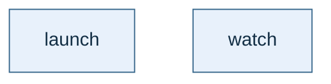

The generated main launcher requires an A100 with approximately 80 GB and starts `scripts.extract_t2i_comparison` through a subprocess.

### Main transfer and finishing entry blocks

[Transfer](backend/gpu/t2i_safe_transfer.py), [receiver](backend/gpu/t2i_safe_receiver.py), and [finisher](backend/gpu/t2i_comparison_finish.py) dispatch directly from `if __name__ == "__main__"` blocks, with no named H1 wrapper. Transfer selects `upload_safe()` or `start_receiver()`; the receiver calls `receive()`; the finisher calls `wait_inputs()` → `start_receiver()` → `launch_analysis()` → `collect_analysis()`, or `record_status()` then re-raises on failure.

The remote analysis worker waits for receiver completion, then invokes measurement/scoring modules in order. Successful collection verifies artifacts and safe-baseline reuse, then **stops the Colab session** as part of the implementation.

### H1: Additional-test client

[Source: main()](backend/gpu/additional_test_client.py) · [H2 details](#h2-gpu-support-workflows)

Given `all`, `launch`, `watch`, `references`, or `finish`, operate on the separate control folder/session. In `all` mode, launch extraction, then run watching, reference transfer, and finishing concurrently while a background heartbeat keeps the session active.

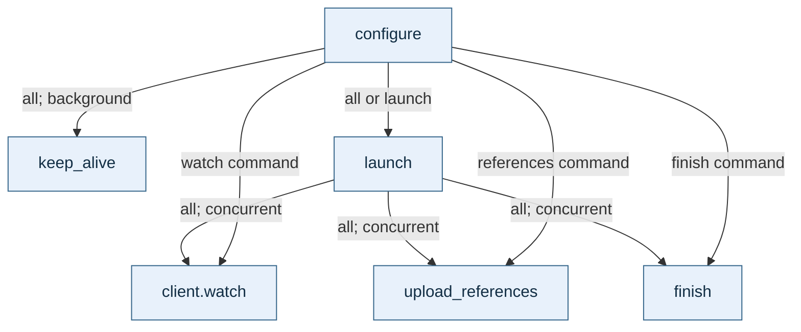

`configure()` mutates imported modules' output/session globals, replaces `finishing.verify_safe_reuse` with `verify_frozen_state`, and wraps `record_status()`. This makes collection context-dependent, contrary to explicit-state rules. The additional launcher requires an A100 with at least approximately 40 GB and passes the control split/resume receipt.

### H2: GPU support workflows

Each expansion shows direct project calls; callback/subprocess handoffs are labelled. See [GPU H3](#h3-gpu-actions) for action purposes and sources.

**launch():** [main](backend/gpu/t2i_comparison_client.py), [additional](backend/gpu/additional_test_client.py). Given prepared inputs and cached authentication, install dependencies, upload a job/temporary credential, and execute a generated extraction launcher. Return without collecting results; packaging/worker generation happen inline.

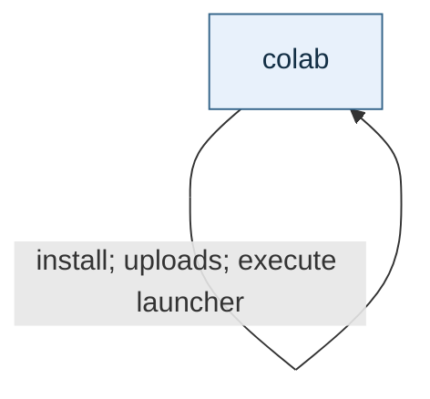

The additional version calls the same definition through `client.colab`.

**watch():** [source](backend/gpu/t2i_comparison_client.py). Given remote status and a local ledger, retrieve pending bundles and return after all expected features are verified. Retry transient polling failures; a failed worker raises after its log is downloaded.

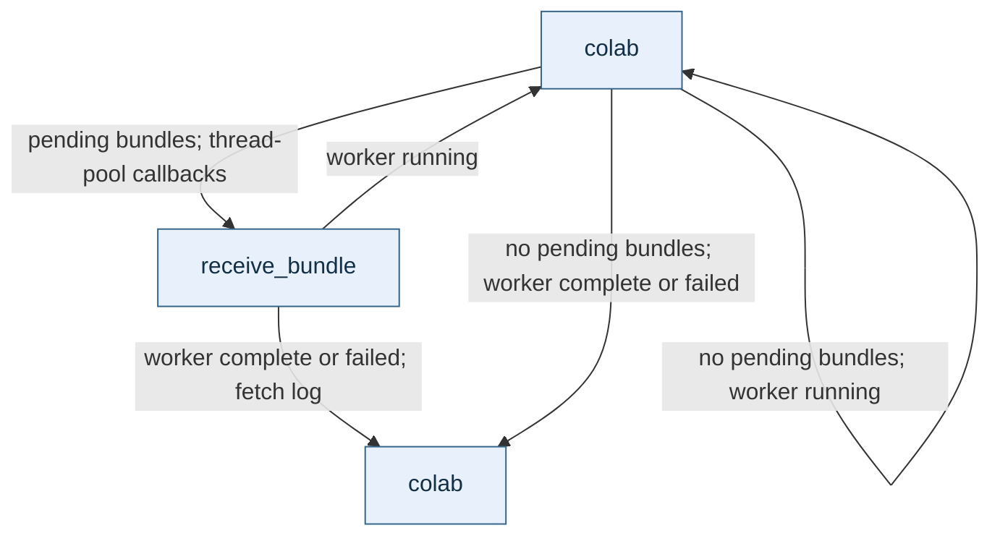

**upload_safe():** [source](backend/gpu/t2i_safe_transfer.py). Given safe-feature receipts, send four-file batches concurrently, record completed batch IDs, and upload a completion marker. Recorded batches are skipped; an already complete ledger goes straight to marker upload.

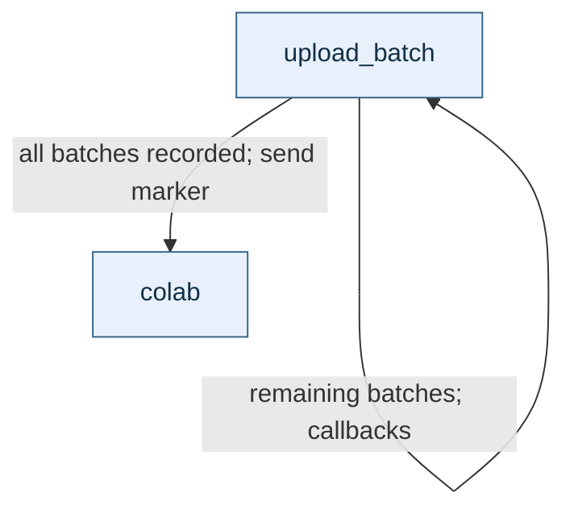

**upload_references():** [source](backend/gpu/additional_test_client.py). Given reference receipts and optional resume data, send reference/restored-control features with the same batching mechanism. Publish the marker after all callbacks complete or recorded batches are skipped.

```mermaid
flowchart TB
    h["client.sha"] -->|optional resume receipt matches experiment| b["transfer.upload_batch"]
    b -->|remaining batches; callbacks| b
    b -->|all batches recorded| c["client.colab"]
    classDef step fill:#e8f1fb,stroke:#35658a,color:#132f45;
    class h,b,c step;
```

Without resume data, execution starts at the callbacks; an already complete ledger bypasses the batch node.

**start_receiver():** [main](backend/gpu/t2i_safe_transfer.py), [additional](backend/gpu/additional_test_client.py). Upload the receiver and start it using a generated launcher; the additional version passes its separate output path.

```mermaid
flowchart TB
    c["colab"] -->|upload receiver; execute launcher| c
    classDef step fill:#e8f1fb,stroke:#35658a,color:#132f45;
    class c step;
```

**receive():** [source](backend/gpu/t2i_safe_receiver.py). Given archives, a completion marker, and a ledger, verify/unpack pending archives and record progress. Return when received batch counts agree with the marker.

```mermaid
flowchart TB
    initial["write_atomic"] -->|pending archives; callbacks| unpack["unpack_verified"]
    unpack --> ledger["write_atomic"]
    ledger -->|next completed archive| unpack
    ledger -->|all received; count matches| complete["write_atomic"]
    initial -->|nothing pending; count matches| complete
    unpack -->|verification failure| failed["write_atomic"]
    ledger -->|count mismatch| failed
    classDef step fill:#e8f1fb,stroke:#35658a,color:#132f45;
    class initial,unpack,ledger,complete,failed step;
```

Errors inside the protected receive block write failed status and re-raise; marker/ledger reads and the first status write precede it. Ledger/progress writes share a node, with archive deletion inline between them.

**wait_inputs():** [source](backend/gpu/t2i_comparison_finish.py). Read extraction/upload progress and publish run status until extraction completes and the remote marker confirms all batches. Return when ready or raise on failed extraction.

```mermaid
flowchart TB
    r["read_state"] --> s["record_status"]
    s -->|inputs incomplete| r
    s -->|extraction complete; upload counts agree| c["colab"]
    c -->|marker missing or mismatched| r
    classDef step fill:#e8f1fb,stroke:#35658a,color:#132f45;
    class r,s,c step;
```

**launch_analysis():** [source](backend/gpu/t2i_comparison_finish.py). Given analysis module names, upload current code/a generated worker and start it remotely. The worker waits for verified receiver completion, invokes modules sequentially, and packages results with hashes.

```mermaid
flowchart TB
    c["colab"] -->|upload code; upload worker; execute launcher| c
    classDef step fill:#e8f1fb,stroke:#35658a,color:#132f45;
    class c step;
```

**launch_evaluation():** [source](backend/gpu/additional_test_client.py). Delegate to the analysis launcher with only `scripts.evaluate_additional_test` and the additional-distance artifact prefix. Return after launch.

```mermaid
flowchart TB
    a["finishing.launch_analysis"]
    classDef step fill:#e8f1fb,stroke:#35658a,color:#132f45;
    class a step;
```

**collect_analysis():** [source](backend/gpu/t2i_comparison_finish.py). Given a remote receipt, verify all returned parts/artifacts, validate preserved experiment state, publish completion, and stop the GPU session.

```mermaid
flowchart TB
    poll["colab"] -->|receipt unavailable; fetch progress| progress["record_status"]
    progress --> poll
    poll -->|complete receipt; download parts| download["colab"]
    download --> check["sha"]
    check -->|next part| download
    check -->|joined archive and existing local files| check
    check -->|artifacts verified inline; fetch log| log["colab"]
    log --> verify["verify_safe_reuse"]
    verify -->|write completion inline; stop session| stop["colab"]
    stop --> done["record_status"]
    classDef step fill:#e8f1fb,stroke:#35658a,color:#132f45;
    class poll,progress,download,check,log,verify,stop,done step;
```

Failed progress retrieval loops without `record_status()`. Failed receipts, bad hashes, conflicting files, or failed validation raise before successful stop/completion. After additional `configure()`, `verify_safe_reuse` invokes `verify_frozen_state()` instead: these are alternative targets, not successive calls.

**finish():** [source](backend/gpu/additional_test_client.py). Given extraction/reference-upload progress, wait for both, start receipt, launch evaluation, and collect verified analysis.

```mermaid
flowchart TB
    r["finishing.read_state"] --> status["finishing.record_status"]
    status -->|extraction or upload incomplete| r
    status -->|both complete| receiver["start_receiver"]
    receiver --> evaluation["launch_evaluation"] --> collect["finishing.collect_analysis"]
    classDef step fill:#e8f1fb,stroke:#35658a,color:#132f45;
    class r,status,receiver,evaluation,collect step;
```

**configure():** [source](backend/gpu/additional_test_client.py). Take no arguments, mutate imported settings, and replace/wrap verification/status functions. It has no named project callees at configuration time, so an H3 diagram would invent a layer; its status wrapper calls the original later.

**keep_alive(done):** [source](backend/gpu/additional_test_client.py). Periodically execute a generated GPU health check until the completion event is set; produce no research artifact.

```mermaid
flowchart TB
    c["client.colab"] -->|repeat until completion event| c
    classDef step fill:#e8f1fb,stroke:#35658a,color:#132f45;
    class c step;
```

### H3: GPU actions

| Function and source | Purpose and further calls |
|---|---|
| [colab](backend/gpu/t2i_comparison_client.py) | Run the authenticated Colab CLI with a timeout; return its result or raise a short command failure. |
| [sha](backend/gpu/t2i_comparison_client.py) | Return a file's SHA-256 digest; the finisher imports this definition. |
| [receive_bundle](backend/gpu/t2i_comparison_client.py) | **Composite:** download via `colab()` with retries, verify archive/extracted/existing-file hashes with `sha()`, validate paths/contents, and return verified file hashes. |
| [upload_batch](backend/gpu/t2i_safe_transfer.py) | Package features/recorded hashes, enforce the 32 MiB upload limit, call `colab()` with retries, and return the batch ID. |
| [unpack_verified](backend/gpu/t2i_safe_receiver.py) | Validate archive contents/paths and each feature hash, write verified files, and return the archive path. Files are checked individually, not staged as one atomic archive commit. |
| [write_atomic](backend/gpu/t2i_safe_receiver.py) | Write ledger/status JSON through a temporary file and replacement. |
| [read_state](backend/gpu/t2i_comparison_finish.py) | Read JSON status with short retries for incomplete JSON. |
| [record_status](backend/gpu/t2i_comparison_finish.py) | Publish `run_status.json` through a temporary file and replacement. |
| [verify_safe_reuse](backend/gpu/t2i_comparison_finish.py) | Resolve the safe source using `safe_source_path()`, check its `sha()`, and compare five safe-only cutoffs/rejection rates with original baselines. Require ten results and write validation. |
| [verify_frozen_state](backend/gpu/additional_test_client.py) | Check parent manifest/comparison with `client.sha()`, compare all ten calibration records with parent rules, and write control-run validation. |

Some GPU status counters/text are fixed to this 1,000-prompt experiment. Manifests and verified receipts carry actual experiment identities/counts.

## Repository map

| Location | Responsibility |
|---|---|
| [scripts](scripts) | Six active command workflows expanded above. |
| [comparison.py](backend/flow/comparison.py) | Method/space combinations, retained-source resolution, reuse, per-space settings. |
| [model.py](backend/flow/model.py), [field_sampling.py](backend/flow/field_sampling.py) | Model interface and signature measurement. |
| [feature_store.py](backend/flow/feature_store.py), [probe_bank.py](backend/flow/probe_bank.py), [extraction_run.py](backend/flow/extraction_run.py) | Stored signatures, validated banks, progress/bundles. |
| [distance_matrix.py](backend/flow/distance_matrix.py), [metrics.py](backend/flow/metrics.py) | Distances and weighted signature loading. |
| [two_mode_scoring.py](backend/flow/two_mode_scoring.py), [two_sets.py](backend/flow/two_sets.py) | Scoring, cutoffs, steering geometry. |
| [common.py](backend/flow/common.py), [prompt_records.py](backend/flow/prompt_records.py), [t2i_prompts.py](backend/flow/t2i_prompts.py) | Settings, paths, serialization, prompt identity/access/partitions. |
| [backend/gpu](backend/gpu) | Colab launch, transfer, collection, session cleanup. |
| [backend/paths.py](backend/paths.py) | Default project/data/validation constants; no workflow functions. Package `__init__.py` files define no pipeline stages. |
| [configs](configs) | Active T2I settings and retained historical configurations, which may reference removed commands. |
| [tests](tests), [fixtures.py](tests/fixtures.py) | CPU checks/toy inputs for field conventions, distances, split isolation, fixed calibration, steering, and extraction resume. |
| [docs/latest-experiment.md](docs/latest-experiment.md) | Commands, prerequisites, retained dependencies. |
| [data/flow_t2i_two_mode_1000](data/flow_t2i_two_mode_1000) | Main artifacts and retained safe source. |
| [additional_tests/style_matched_safe_prompts_1000](data/flow_t2i_two_mode_1000/additional_tests/style_matched_safe_prompts_1000) | Separate controls, parent state, signatures, results. |
| [flow_matching_safe_set_POC_JP/README.md](flow_matching_safe_set_POC_JP/README.md) | Conceptual reference; this directory contains no executable implementation here. |
| [archive](archive) | Historical UI, embeddings, validation, storage, GPU, research code outside the active call graph. See its [README](archive/README.md) and [research overview](archive/research/README.md). |

### Retained helpers outside the active pipeline

These support tests/earlier experiments; they are not extra current pipeline stages. Current preparation reuses safe splits/banks rather than rebuilding them.

| Source/functions | Purpose and existing calls |
|---|---|
| [prompt_records.py](backend/flow/prompt_records.py): `split_corpus`, `_validate_source_row` | Convert an earlier corpus into safe-reference/validation/test and unsafe-test groups. `split_corpus()` calls `_validate_source_row()`/`canonical()` to check metadata and remove duplicates. |
| [probe_geometry.py](backend/flow/probe_geometry.py): `time_grid`, `_integrate_trajectory`, `sample_trajectories`, `source_bank` | Build a schedule, trace seeded safe paths, reconstruct paired noises. `sample_trajectories()` calls `time_grid()` then `_integrate_trajectory()` per prompt; integration calls `FlowAdapter.encode()` then `guided_velocity()` per step. |
| [model.py](backend/flow/model.py): `FlowAdapter.guided_velocity` | Call `velocity_pair()` and combine empty/prompted directions for path tracing; current extraction uses `prompt_effect()` on existing states. |
| [probe_bank.py](backend/flow/probe_bank.py): `build_bank` | Package states, weights, times, provenance; use `resolved_path()`/`sha256()` to bind the safe-fit split. |
| [anchor_scoring.py](backend/flow/anchor_scoring.py): `normalize_method`, `scoring_config`, `anchor_distances`, `fit_anchor_scoring`, `mean_anchor_distance`, `weighted_distance`, `anchor_score`, `require_current_scoring` | Tensor scoring: `scoring_config()` normalizes settings; `fit_anchor_scoring()` calls it and, for adaptive weighting, `anchor_distances()`. `anchor_score()` uses `mean_anchor_distance()` for uniform scoring, otherwise `anchor_distances()` then `weighted_distance()`. `require_current_scoring()` checks saved rules using `scoring_config()`; tests compare these definitions with active table scoring. |
| [metrics.py](backend/flow/metrics.py): `nearest`, `write_scores`, `reference_history`, `score_rows` | Earlier workflow: `nearest()` calls `anchor_score()`; `reference_history()` loads bank/rows/flattened references; `score_rows()` optionally fits a rule and calls `flat_feature()`/`anchor_score()` per row; `write_scores()` validates the rule and writes decisions/provenance. Only `flat_feature()` is used by current measurement. |
| [thresholds.py](backend/flow/thresholds.py): `calculate_threshold` | Convert calibration records into a cutoff record; `None` represents an unlimited cutoff when the rank exceeds the sample. Current scoring uses `conformal_cutoff()`. |
| [two_sets.py](backend/flow/two_sets.py): `membership`, `_convex_sublevel`, `repair_segment` | Describe overlapping regions/search static mean-distance mixtures. `repair_segment()` calls `_convex_sublevel()` with score callbacks using `mixture_distances()`; current steering uses `steer_segment()`. |

### Saved artifacts and progress

| Artifact | Meaning / producer |
|---|---|
| `experiment.json`, `*/splits/*.jsonl` | Frozen settings/identities/ordered groups / preparation. |
| `*/probes/probe_bank.pt`, `*/features/<split>/<id>.pt` | Reused banks and reused/new signatures / preparation and extraction. |
| `status.json`, `transfer/part-*.zip`, `*features.provenance.json` | Extraction progress, bundles, identity / `Run` and extraction; reference receipts also come from control preparation. |
| `*/safe_distances.npz` | Original safe cache / main preparation. |
| `*/two_mode_distances.npz`, matching provenance | Main query-to-safe/unsafe tables / measurement. |
| `frozen_calibration.json`, `parent_comparison.json`, `*/frozen_geometry.npz` | Copied parent rules/results/distance slices / control preparation. |
| `*/additional_distances.npz`, matching provenance | New-control distances / additional measurement. |
| `variants/<space>_<method>/calibration.json` | Fitted rules/cutoffs / main scoring only. |
| `variants/<space>_<method>/<mode>/decisions_and_steering.csv`, `report.json` | Per-prompt flags/steering/summaries / scoring. |
| `comparison.md`, `.csv`, `.json`, `.provenance.json` | Combined results/artifact identities / reporting. |
| `analysis_status.json` | Measurement/comparison progress / commands and GPU collection. |
| `download_status.json`, `safe_upload_status.json`, `safe_received.json`, `safe_transfer_status.json` | Transfer ledgers/progress / GPU helpers. |
| `run_status.json`, `safe_reuse_validation.json` or `frozen_state_validation.json` | GPU orchestration status/successful preservation checks. |

Run retained CPU checks with:

```powershell
python -m unittest discover -s tests
```

## Hierarchy findings

This README describes the current working tree. These deviations prevent a fully compliant H0 → H3 call tree without source changes:

| Finding | Evidence / consequence |
|---|---|
| No global orchestrator | The sequence is separate commands; H0 arrows are file dependencies, not calls from an existing function. |
| H1 naming/role mismatch | Command orchestrators are `main()`; `run_extraction()` has an H1-style name beneath a command wrapper. |
| Adjacent-level skipping/inline work | H1 wrappers parse arguments, set threads, load configuration/resume data, or write status directly. H2 bodies also combine coordination/calculations/I/O. |
| Shared rather than same-file actions | Steps import helpers from other modules instead of calling same-file H3 actions only. |
| Atomic naming/boundary deviations | Most actions lack an underscore. Composite helpers (`read_bank`, `Run.bundle`, `calculate`, `steer_queries`, `steer_segment`, etc.) contain further coordination; H3 tables expose their calls. |
| Cross-step imports | Additional evaluation imports scoring helpers from the main scoring script and constants from additional preparation. |
| Implicit cross-step state | Additional GPU `configure()` rewrites globals and replaces verification/status callbacks; collection's verifier depends on earlier configuration. |
| File layout differs | Scripts put `main()` last but do not provide grouped same-file H3 → H2 → H1 layers; most actions are shared. Transfer/receiver/finisher entry blocks lack named H1 wrappers. |
| Indirect handoffs | Thread pools invoke callbacks; generated workers invoke modules via subprocesses. Those relationships are labelled instead of presented as ordinary local calls. |
| Historical files absent | IDE-referenced `backend/gpu/safe_flow_client.py` and earlier `backend/flow/workflow.py` / `backend/flow_experiment.py` are absent here; their historical workflows are not current stages. |

Linked sources disambiguate repeated names (`main`, `prepare`, `report`, `load`, `launch`, `start_receiver`). Missing layers remain explicit; diagrams do not introduce wrappers or claim the implementation conforms to the guide.
