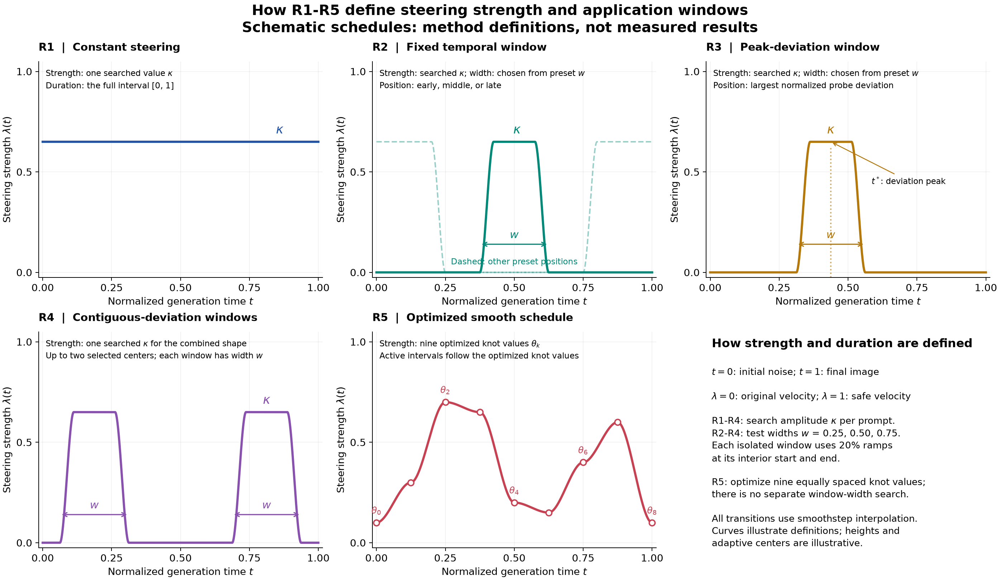

# How R1--R5 define steering strength and application windows

The five graphs illustrate the **method definitions**. Their heights, adaptive
centers, and R5 knot values are schematic examples. They are not measured
schedules or claims that the displayed curves satisfy detector constraints.

The x-axis is normalized generation time t: zero is initial noise and one is
the final image. The y-axis is the mixing weight lambda(t), between zero
(original-prompt velocity) and one (approved safe-reference velocity). Both
velocities are evaluated at the current repaired latent. The schedule is
selected before generation and then held fixed.

## Strength and window definitions

For R1--R4, write **lambda(t) = kappa * s(t)**. The scalar kappa in [0, 1] is
searched separately for each prompt, while s(t) defines the temporal shape.
For each fixed shape, the search tests 257 strengths, refines the entry to
each detected feasible interval with 12 bisections, and retains the smallest
verified strength found. Feasibility uses the frozen detector constraints;
joint mode requires both safe attraction and unsafe avoidance.

| Method | How strength is defined | How position and length are defined |
|---|---|---|
| [R1: constant](figures/steering-r1.svg) | One searched kappa; lambda(t) = kappa throughout generation. | Full interval [0, 1], of length 1. No window search. |
| [R2: fixed window](figures/steering-r2.svg) | Search kappa for each candidate window. | Test widths w in {0.25, 0.50, 0.75}. For each width, test early [0, w], middle [(1-w)/2, (1+w)/2], and late [1-w, 1]. |
| [R3: peak deviation](figures/steering-r3.svg) | Search kappa for each candidate width. | Center at the probe time with the largest normalized per-probe query-to-anchor deviation. Test the same three widths; shift boundary windows inward to preserve width. |
| [R4: contiguous deviation](figures/steering-r4.svg) | Search one common kappa for each combined window shape. | For each width and deviation statistic (mean, top-10%, top-25%), rank candidate windows by average deviation. Select up to two centers separated by at least w; each window has that width. Boundary shifts can make them overlap. |
| [R5: optimized smooth](figures/steering-r5.svg) | Optimize nine individual strengths theta_k in [0, 1], at times t_k = k/8. | There is no separate window-width parameter. Nonzero knot values and interpolation determine when steering is active. Knot spacing 0.125 is not a prescribed application-window length. |

For R2--R4, the retained feasible candidate has the smallest integrated
strength found across the tested shapes. Thus a wider window with a lower
height can compete with a narrower window with a higher height. Width is
chosen from the configured list; it is not optimized continuously. These are
bounded numerical searches, without a guarantee of the global minimum.

## Ramps, boundaries, and multiple windows

An isolated window of total width w has an entry ramp of length **0.2w**, a
plateau of length **0.6w**, and an exit ramp of length **0.2w**. Width includes
both ramps. Each ramp interpolates using smoothstep, S(u) = 3u^2 - 2u^3.
If a window touches t = 0 or t = 1, its outer ramp is omitted and full strength
continues to that boundary; the total window width stays w.

R3 and R4 use frozen-probe deviations normalized using safe-validation data.
Their positions are selected before generation; they do not track deviation
live along the generated trajectory. R4 combines windows into one bounded
shape, rather than adding their amplitudes. Its total active duration is the
length of their union, which can exceed one window's width.

## R5's flexible duration

R5 interpolates the nine knot values using smoothstep and minimizes
**integrated strength + 0.01 * integrated squared time derivative**, subject
to the detector constraints. Deterministic multistart coordinate search adjusts
the knot values. A segment is identically zero when both endpoint strengths
are zero; otherwise its interior has positive steering. The optimized knot
pattern therefore determines active duration. Steering may remain active over
the full trajectory or be concentrated in shorter intervals.

Downloads: [combined SVG](figures/steering-schedules.svg),
[combined PDF](figures/steering-schedules.pdf),
[illustrative curve data](figures/steering-schedules.csv), and
[plotting script](figures/plot_steering_schedules.py).
Individual graphs are linked in the table. Their values are explicitly
identified as illustrative in the [provenance](figures/steering-schedules.provenance.json).
Method definitions come from [the implementation](../../backend/src/repair/steering.py)
and [the configuration](../../backend/experiments/five_category_nudity_repair_20pairs_20261102/config.toml).
